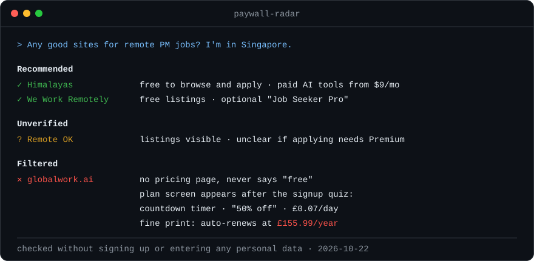

<div align="center">

# paywall-radar

**Stop your AI from recommending sites that make you fill in a 10-step quiz, then ask for your credit card.**

An agent skill that screens websites for hidden paywalls *before* recommending them, without signing up or giving away any of your data.

[](LICENSE)
[](https://agentskills.io)
[](scripts/probe.py)

[English](README.md) · [简体中文](README.zh-CN.md)



</div>

## The problem

You ask your AI for remote job sites. It gives you a list. You click one, and it asks what role you want. Then your experience level, salary range and preferred time zone, then it wants your resume. Twenty minutes later:

> **Choose your plan** · ⏱ 09:52 · ~~£0.43~~ **£0.07 per day** · 50% DISCOUNT
> *Without cancellation ... will automatically charge 155.99 GBP every 1 year until I cancel.*

That one is real (observed 2026-10-22). The homepage never mentions a price, never says "free", and has no pricing page. Your AI had no way of knowing, so it recommended the site anyway.

**paywall-radar teaches your agent to check first.**

## What it does

Whenever your agent is about to recommend websites, apps or online tools, or you ask "is this site free?", it screens each one and sorts it:

| Verdict | Meaning |
|---|---|
| ✅ **FREE** | The thing you came to do is free |
| ✅ **FREE TIER OK** | The free tier gets the job done; paid extras are listed |
| ❔ **UNVERIFIED** | Not enough evidence, so it is marked "may charge" and not passed off as free |
| ⛔ **FILTERED** | You can't do the core task without paying, and it says whether the price is hidden or shown openly |

Filtered sites still get one line at the end with the reason, so you recognize them if you come across them elsewhere.

## How it sees the paywall without signing up

The hard part: the paywall sits behind the quiz, and the agent can't (and shouldn't) fill the quiz in with your details. So it looks around the funnel instead of through it:

1. **Public info outside the funnel.** It reads the pricing page, the FAQ, and the terms (searching for *auto-renew, recurring, trial, refund*). It checks app store in-app purchases and Reddit/Trustpilot reviews. A money-back policy on a site that never shows a price says a lot.
2. **The site's own code.** Every visitor's browser downloads the site's JavaScript. If that code contains routes like `choosePlan`, `limitedOffer` or `/start/payment-process`, there is a plan screen at the end of the flow, whatever the homepage says.
3. **Skipping ahead by URL.** Funnels often number their steps (`/journey/2/join/10`). Changing the number sometimes lands straight on the plan page.
4. **Testing the real task.** It opens a job listing and checks whether "Apply" works without an account, or whether the resume export is actually free.
5. **No evidence of free means not free.** Genuinely free products say "free" loudly, because it's their best selling point.

The bundled probe covers the code and policy-page checks in about 7 seconds per site:

```text
$ python3 scripts/probe.py https://globalwork.ai/en

=== https://globalwork.ai/en
  pricing link on page:         no
  says 'free' out loud:         no
  payment provider in code:     none found
  paywall/funnel code signals:  choose-plan step, checkout / payment step, upsell / limited offer,
                                subscription API, pricing API, auto-renew wording
  billing terms in policy pages: YES
    [choose-plan step] choosePlan:"/platform/settings/manage-subscription/choose-plan",limitedOffer:...
    [checkout / payment step] payment_processing:"/start/payment-process/processing",...
```

Pure Python standard library, no API keys, read-only. It never submits a form.

### Calibrated on real sites

Subscription terms show up almost everywhere, even on job boards that are free for job seekers, so they don't count for much. What separated the trap was the combination: **no pricing link, never says "free", and paywall routes in the code.**

| Site | Pricing link | Says "free" | Paywall code | Result |
|---|---|---|---|---|
| globalwork.ai | ✗ | ✗ | 6 signals | ⛔ hidden paywall |
| himalayas.app | ✓ | ✓ | none | ✅ free tier OK |
| weworkremotely.com | ✓ | ✗ | none | ✅ free tier OK |

Details: [`references/signals.md`](references/signals.md) · Verified sites: [`references/known-sites.md`](references/known-sites.md)

## Install

Built on the open [Agent Skills](https://agentskills.io) standard (`SKILL.md` + `scripts/`). Put the folder in your tool's skills directory.

| Tool | Install |
|---|---|
| **Claude Code** | `git clone https://github.com/rey0905/paywall-radar.git ~/.claude/skills/paywall-radar` |
| **Any skills CLI** ([skills.sh](https://skills.sh)) | `npx skills add rey0905/paywall-radar` |
| **Codex CLI** | `git clone https://github.com/rey0905/paywall-radar.git ~/.codex/skills/paywall-radar` |
| **Cursor / Gemini CLI / Copilot** | Same clone, into that tool's skills directory |
| **claude.ai and other web apps** | Download [paywall-radar.zip](https://github.com/rey0905/paywall-radar/releases/latest/download/paywall-radar.zip) and upload it under Settings → Skills |
| **Anything else** | Paste `SKILL.md` into the chat. It is a self-contained playbook. |

Then just ask naturally: *"any free sites for X?"*, *"is this site legit or will it make me pay?"*, or paste a signup link you're stuck on.

**Chat in Chinese?** A full Chinese edition lives in [`paywall-radar-zh/`](paywall-radar-zh/), with its own instructions, references and Chinese probe output. Install that folder instead of the repo root (see the [Chinese README](README.zh-CN.md#安装)). Install one edition, not both.

## What it will never do

1. Sign up, enter your email, name, phone or resume, or click anything that buys or starts a trial.
2. Call a company a scam. It reports dated facts ("no pricing page; auto-renews at £155.99/year") and lets you judge.
3. Click through a questionnaire unless you say OK for that specific site, and even then only with non-personal answers, stopping at the email screen.

## Already got caught?

Paste the link. The skill tells you whether there is any free path, what you'd really be charged (the renewal amount, not the per-day figure), and how to check for an active subscription and request deletion of the data you uploaded.

## Contributing: add a site

The ledger gets more useful with every site. Found a hidden paywall, or a site that's genuinely free?

**[Open an issue](../../issues/new?template=report-site.yml)** with the URL and what you saw, or **send a PR** adding a row to [`references/known-sites.md`](references/known-sites.md).

Rows need **observed facts with a date** (what the page said, where you saw it). No opinions, no "scam" labels. That keeps the list useful and fair.

Improvements to the probe's detection patterns are very welcome too. Please include a site where your change makes a difference. The probe exists in both editions (`scripts/probe.py` and `paywall-radar-zh/scripts/probe.py`), and CI checks that the two copies are identical.

## Limitations

1. Some funnels reveal nothing until you've registered. Those end up as **UNVERIFIED**, not as false "free" claims.
2. Pricing changes. Ledger rows older than 90 days get re-checked.
3. The probe reads static HTML and scripts. Heavily client-rendered pages may need the agent's browser tool, and the skill tells it when.

---

<div align="center">

**If this saved you from one 20-minute signup quiz, a ⭐ helps other people find it.**

MIT License

</div>
