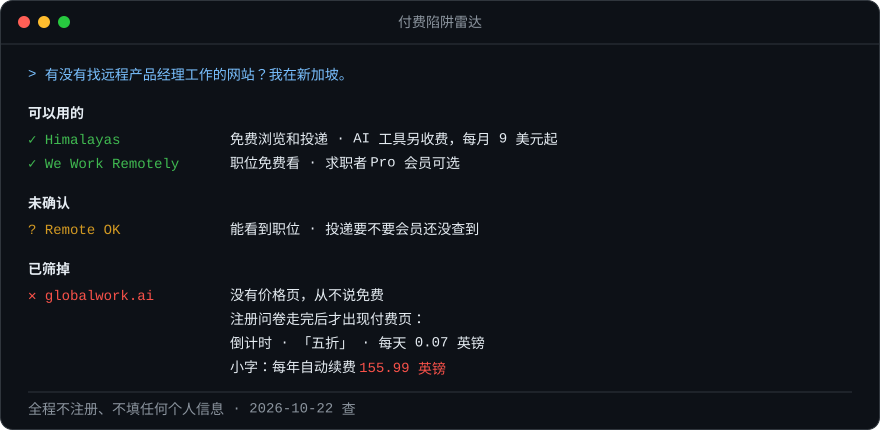

<div align="center">

# 付费陷阱雷达 paywall-radar

**别再让 AI 给你推荐那种「填完 10 页问卷，最后让你绑卡买会员」的网站。**

一个 AI skill：在推荐网站之前，先查它有没有藏起来的付费墙。整个过程不注册，也不交出你的任何信息。

[](LICENSE)
[](https://agentskills.io)
[](paywall-radar-zh/scripts/probe.py)

[English](README.md) · [简体中文](README.zh-CN.md)



</div>

## 为什么做这个

我让 AI 推荐几个找远程工作的网站，它给了一串。我点开其中一个，它先问我想找什么职位，再问经验、期望薪资、时区，然后让我上传简历。二十分钟后，页面上出现：

> **选择你的方案**，倒计时 09:52，原价 ~~每天 0.43 英镑~~ 现在 **每天只要 0.07 英镑**，五折优惠
> 页面底部小字：*不取消的话，每年自动扣款 155.99 英镑，直到你取消为止。*

这是真实经历（2026-10-22）。这个网站的首页从头到尾没写价格，没说过「免费」，也没有价格页。AI 根本不知道这些，所以照样推荐给了我。

**付费陷阱雷达让 AI 在推荐之前先查一遍。**

## 它做什么

每当 AI 准备给你推荐网站、App 或在线工具，或者你问「这个网站免费吗」，它会先逐个检查，再分成四类：

| 结论 | 意思 |
|---|---|
| ✅ **免费** | 你要做的那件事，不花钱就能做完 |
| ✅ **免费版够用** | 免费版能完成任务，同时写明哪些功能另外收费 |
| ❔ **未确认** | 证据不够，标成「可能收费」，不会当免费推荐 |
| ⛔ **已筛掉** | 不付钱就做不了你要做的事，并注明价格是藏在最后才出现，还是一开始就公开写明 |

被筛掉的网站不会完全消失，会在最后列一行并写明原因。这样你在别处看到它时，就知道是同一个坑。

## 不注册，怎么看到最后的付费页

难点在于：付费页藏在问卷后面，AI 不能、也不应该用你的信息去填问卷。所以它不走流程，而是从流程外面找证据：

**第一，查流程外面的公开信息。** 看价格页、常见问题和使用条款，在条款里搜「自动续费、订阅、试用、退款」这些词。如果有 App，就去应用商店看「App 内购买项目」，那里会列出真实价格。再搜 Reddit 和 Trustpilot 上的用户评价。一个从不标价的网站却专门写了退款政策，这本身就说明问题。

**第二，看网站自己的代码。** 每个访客的浏览器都会下载网站的 JavaScript 代码。如果代码里写着 `choosePlan`（选方案）、`limitedOffer`（限时优惠）、`/start/payment-process`（付款处理）这类页面，说明流程最后一定有付费页，不管首页怎么说。

**第三，改网址跳步。** 很多这类网站把步骤编号写在网址里，比如 `/journey/2/join/10`。改一下数字，有时能直接跳到付费页。

**第四，亲自试一下核心功能。** 比如打开一个职位，看不登录能不能点「申请」；或者看简历导出是不是真的免费。

**第五，找不到免费的证据，就不当免费。** 真正免费的产品都会把「免费」写得很大，因为这是它最好的卖点。

自带的检测脚本负责查代码和政策页，每个网站大约 7 秒，加上 `--zh` 参数会用中文输出：

```text
$ python3 scripts/probe.py --zh https://globalwork.ai/en

=== https://globalwork.ai/en
  页面上有价格页链接：    否
  明确写了免费：          否
  代码里的收款服务：      未发现
  代码里的付费流程信号：  选方案步骤、结账付款步骤、加价推销或限时优惠、订阅接口、价格接口、自动续费字样
  政策页里有收费条款：    是
```

只用 Python 自带的标准库，不需要任何密钥，只读不写，绝不提交任何表单。

### 用真实网站校准过

测试中发现，几乎所有网站的条款里都有订阅收费条款，连对求职者免费的招聘网站也有，所以单看这一条说明不了什么。真正把陷阱和正常网站分开的，是三条同时出现：**没有价格页、从不说免费、代码里有付费流程。**

| 网站 | 有价格页 | 说免费 | 代码里有付费流程 | 结论 |
|---|---|---|---|---|
| globalwork.ai | ✗ | ✗ | 6 类信号 | ⛔ 隐藏付费墙 |
| himalayas.app | ✓ | ✓ | 无 | ✅ 免费版够用 |
| weworkremotely.com | ✓ | ✗ | 无 | ✅ 免费版够用 |

还有一种套路要靠第四步才能识破：写着免费，但免费刚好做不完你要做的事。比如 zety.com 写着「基础版免费」，可免费版只能下载 TXT 纯文本，要 PDF 简历就得开试用，之后每 4 周自动扣 34.95 新加坡元。

判断规则详见 [`paywall-radar-zh/references/signals.md`](paywall-radar-zh/references/signals.md)，已核实的网站名单见 [`paywall-radar-zh/references/known-sites.md`](paywall-radar-zh/references/known-sites.md)。

## 安装

仓库里有两个版本，内容一样，只是语言不同。**中文版在 `paywall-radar-zh/` 文件夹里**，平时用中文和 AI 对话就装这个。两个版本装一个就够了，不要同时装。

本仓库采用开放的 [Agent Skills](https://agentskills.io) 标准，把 `paywall-radar-zh` 文件夹放进你所用工具的 skills 目录就行。

**Claude Code**

```bash
git clone https://github.com/rey0905/paywall-radar.git
cp -r paywall-radar/paywall-radar-zh ~/.claude/skills/paywall-radar-zh
```

**Codex CLI**：同样两步，第二步的目标改成 `~/.codex/skills/paywall-radar-zh`。

**Cursor、Gemini CLI、Copilot 等**：同样两步，目标改成该工具的 skills 目录。

**claude.ai 等网页版**：下载 [paywall-radar-zh.zip](https://github.com/rey0905/paywall-radar/releases/latest/download/paywall-radar-zh.zip)，在设置的 Skills 页上传。

**其他任何 AI**：把 `paywall-radar-zh/SKILL.md` 全文发给它，它是一份自足的操作手册。

装好后正常说话就能触发，比如「有没有免费的 ×× 网站」「这个网站靠谱吗，会不会让我付费」，或者直接贴一个你卡住的注册链接。

## 它绝不会做的事

1. 注册账号，填你的邮箱、姓名、电话、简历，或者点任何购买、开始试用的按钮。
2. 说某家公司是骗子。它只报告带日期的事实（比如「没有价格页；每年自动续费 155.99 英镑」），由你自己判断。
3. 未经你同意就点问卷。就算你同意了，也只选不涉及个人信息的选项，到要填邮箱的那一步就停下。

## 已经踩坑了？

把链接贴给它。它会告诉你：有没有免费的路可走；实际会被扣多少钱（是续费金额，不是「每天几毛」）；怎么检查自己有没有开通订阅，以及怎么要求网站删除你上传的资料。

## 一起补充名单

名单里的网站越多，这个 skill 越有用。如果你遇到了藏起来的付费墙，或者确认某个网站真的免费，欢迎 **[提一个 issue](../../issues/new?template=report-site.yml)** 写上网址和你看到的情况，或者直接 **提 PR** 在 [`paywall-radar-zh/references/known-sites.md`](paywall-radar-zh/references/known-sites.md) 里加一行。

每一行都要写**带日期的事实**（页面上写了什么、在哪里看到的），不写主观评价，不贴「骗子」标签。这样名单才公正，也才有用。

也欢迎改进检测脚本的匹配规则，请附上一个你的改动能识别出差别的网站。脚本在两个版本里各有一份，自动检查会确保两份完全一样。

## 局限

1. 有些网站不注册什么都不显示，这类会被标成**未确认**，而不会被误判成免费。
2. 网站的收费方式会变，名单里超过 90 天的记录会重新核实。
3. 检测脚本读的是静态网页和代码。完全靠浏览器渲染的页面，需要 AI 用浏览器工具打开看，skill 里写明了什么时候该这么做。

---

<div align="center">

**如果它帮你躲过了一次二十分钟的注册问卷，点个 ⭐ 能让更多人看到它。**

MIT 许可证

</div>
